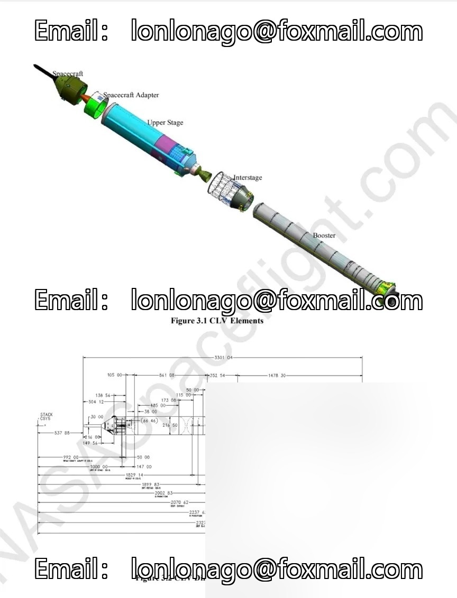
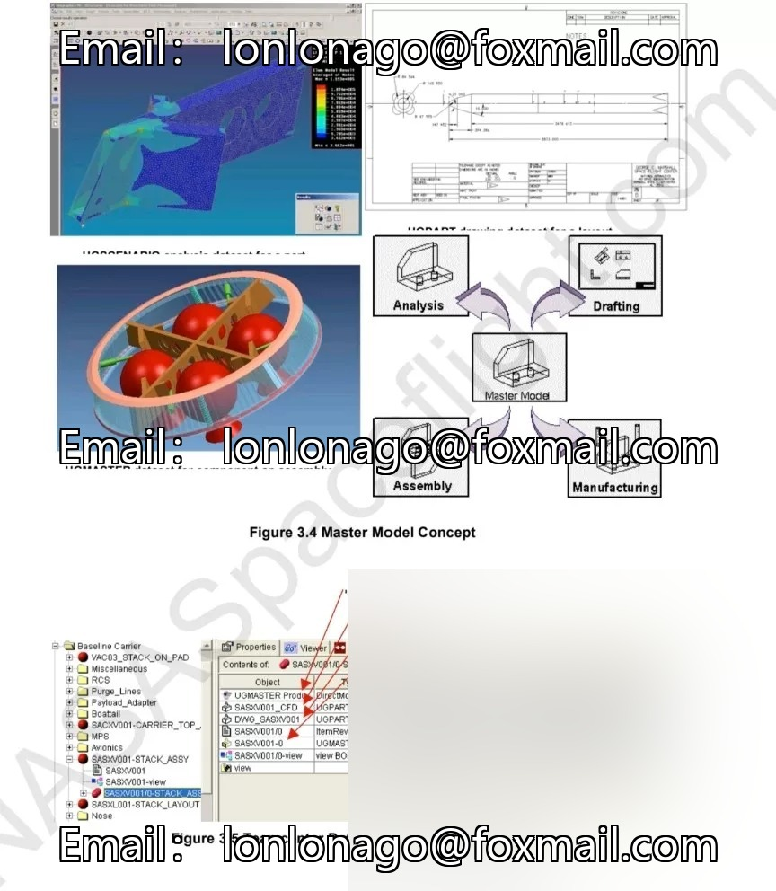
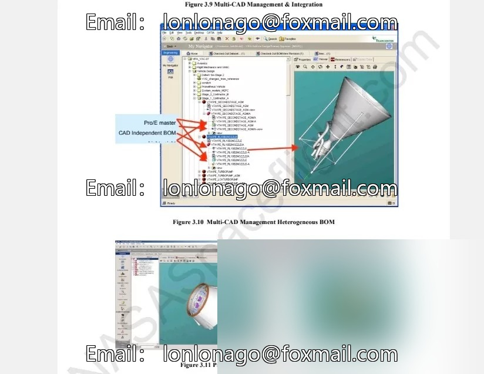
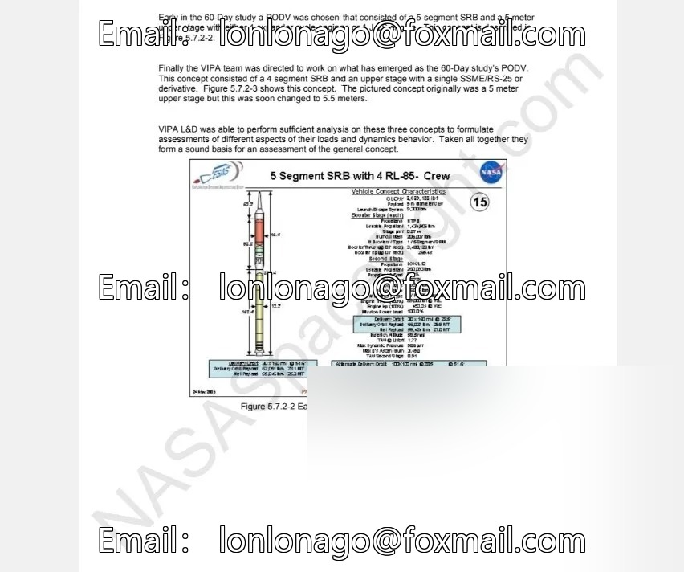

# NASA “Constellation Plan”

## Body

NASA “Constellation Program” (2008-2010) core top-level design document.
"SBU - Sensitive But Unclassified" (Sensitive but not classified) and "For NASA Internal Use Only" (For use by NASA internally).
PDF file of 600 pages
The original goal of the plan was to return to the moon and establish a forward base. In 2010, due to overspend and technical risks, the Obama government canceled the “Constellation Program”

The NASA "Constellation Program" is a core top-level design document from roughly 2008 to 2010 with the goal of returning to the moon and establishing a front-line base; the program was cancelled due to budget overruns and technical risks.

<!-- AI_ENRICHED -->

## Images

## Payment

Here is a pay link on Stripe ( https://buy.stripe.com/3cs8yP7sY87d0vu9AB ). Please contact me lonlonago@foxmail.com after funding $89, and I will send you a complete data files , thank you!

